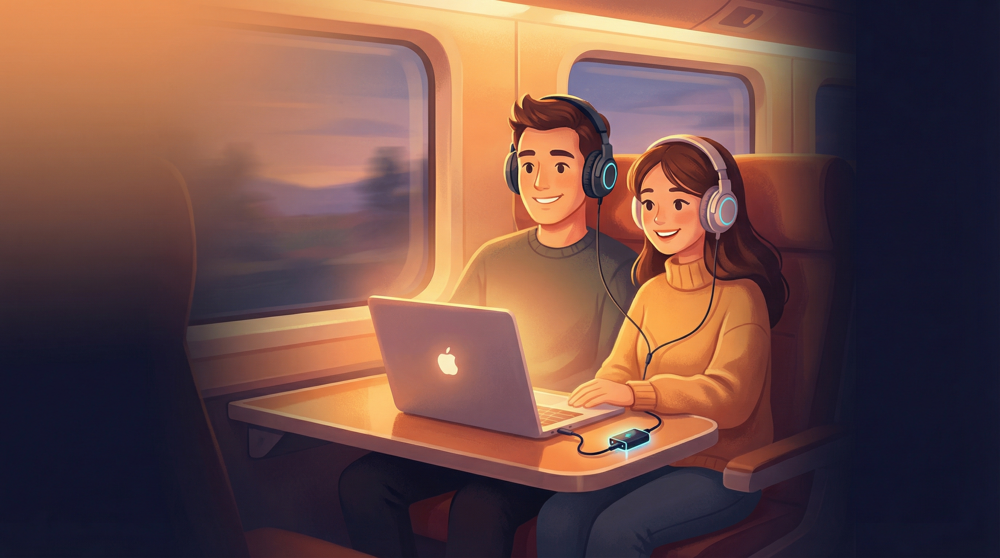

  

<h1 align="center">Double Headphones</h1>

  <strong>Share audio to multiple headphones simultaneously on Windows</strong> 
  No drivers. No complexity. Just click and listen.

  
  &nbsp;
  

---

## The Problem

You're on a train with your partner. You want to watch a movie together on your laptop. But Windows only plays audio through **one device at a time**.

Your options? Share one pair of earbuds (uncomfortable). Use a splitter cable (who carries those?). Let one person use the laptop speaker (everyone on the train hates you).

## The Solution

**Double Headphones** captures your system audio and routes it to two output devices at the same time. Bluetooth, wired, USB — any combination works.

1. Connect both headphones
2. Select them in the app
3. Click **Share Audio**
4. Both headphones play the same audio, in sync

That's it. When you stop sharing, everything goes back to normal automatically.

## Features

- **Dual-device output** — play audio on two devices simultaneously (more than two is planned)
- **No drivers required** — pure Windows APIs, nothing to install
- **Dead simple** — three dropdowns and one button
- **Any headphones** — Bluetooth, wired, USB DACs, speakers, any mix
- **Per-device volume** — adjust each output independently
- **Latency compensation** — align Bluetooth with wired using a 0–2 second delay slider (type an exact value too)
- **Crash-safe** — if the app crashes, your audio restores automatically
- **Lightweight** — under 5% CPU
- **Free forever** — no ads, no telemetry, no tracking, no trial

## Download

**[Download DoubleHeadphones.exe](https://github.com/maayaranai/double-headphones/releases/latest)** (Windows 10/11, 64-bit)

Single portable .exe — no installation needed. Just download and run.

## System Requirements

| | Minimum |
|---|---|
| **OS** | Windows 10 (build 20348+) or Windows 11 |
| **Arch** | 64-bit (x64) |
| **Audio** | Two or more output devices connected |

## FAQ

<strong>Why do I hear audio from my laptop speakers?</strong>

 
You shouldn't. When one of your chosen outputs is also your Windows default device, the app quietly hands the default off to a spare output and mutes it, so nothing leaks out. If your machine has no spare device to hand it to, that one output plays normally and the app tells you — set a different device as your Windows default to silence it.

<strong>Netflix/Disney+ audio is silent</strong>

 
Streaming apps with DRM block audio capture. Use Chrome instead of the native Windows app — it works perfectly.

<strong>Audio is out of sync with video</strong>

 
Bluetooth adds 150-250ms of latency. Use the latency slider in the app, or adjust audio delay in your video player (VLC: press J/K).

<strong>Two Bluetooth headphones are stuttering</strong>

 
Two Bluetooth devices at once usually works fine — it's the whole point of the app. If you do hit stutters, moving the headphones closer to the PC helps most. On rare setups where a single built-in adapter can't keep up with two streams, a spare USB Bluetooth adapter (~$10) removes the bottleneck.

<strong>Can I use more than 2 devices?</strong>

 
Not yet. The current version shares to two devices. Adding more is planned for the next version — follow <a href="https://github.com/maayaranai/double-headphones/issues/10">issue #10</a>.

<strong>My Discord viewers hear the stream audio doubled</strong>

 
Share the specific application window in Discord instead of your entire screen. Screen sharing records the sound of every app, including the copy Double Headphones plays to your second device.

<strong>The volume keys on my keyboard do nothing while sharing</strong>

 
While sharing, use the two volume sliders in the app. Following the Windows volume keys is planned for the next version.

<strong>Something isn't working — how do I report it?</strong>

 
Open an <a href="https://github.com/maayaranai/double-headphones/issues">issue</a> and attach the log file. Press <code>Win + R</code>, paste <code>%AppData%\DoubleHeadphones\logs</code>, press Enter, and attach <code>doubleheadphones.log</code>.

## Known Limitations

- **DRM content** (Netflix app, Edge) — use Chrome as workaround
- **Bluetooth latency** (150-250ms) — physics, use the latency slider
- **Dual Bluetooth** — works on most setups; a rare built-in adapter may stutter (move devices closer, or add a spare USB adapter)
- **Two outputs at a time** — more are planned
- **FxSound** — may conflict while it is running; quit FxSound before sharing
- **Windows 10 before build 20348** — required API not available

## Support Development

Double Headphones is free forever. If it saves you from sharing earbuds on your next trip, consider [buying me a coffee](https://ko-fi.com/ranmazor).

## License

Proprietary — free for personal use. See [LICENSE](LICENSE) for details.

---

Built with ♥ for couples who travel together

